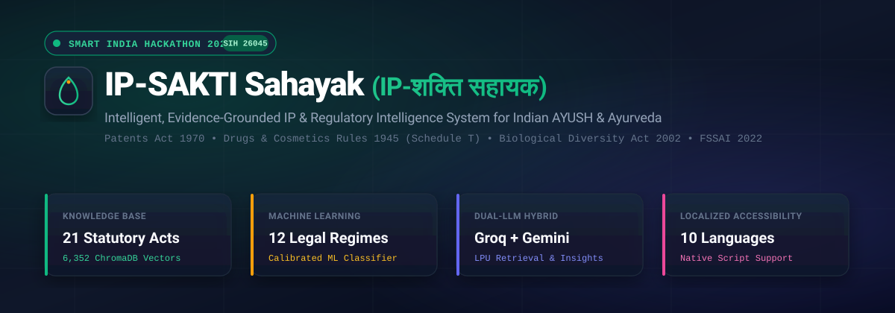
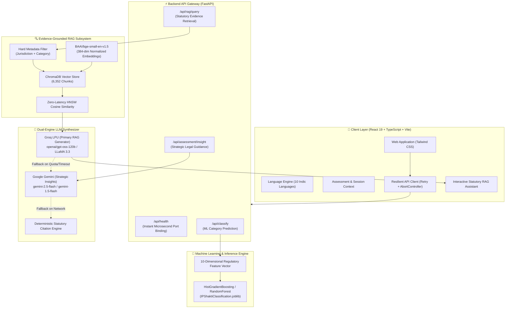
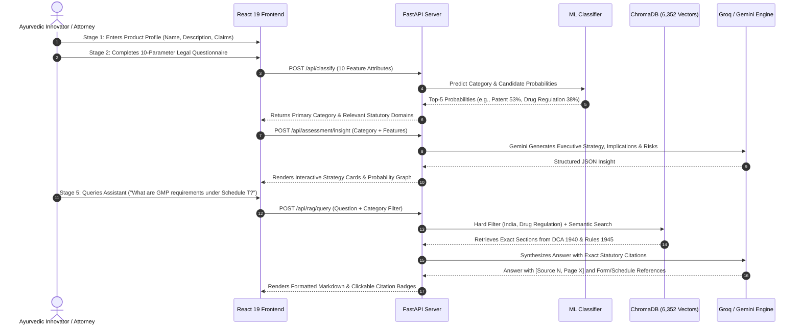

<p align="center">
  
</p>

<p align="center">
  <strong>Smart India Hackathon (SIH 2026) — Problem Statement SIH 26045</strong><br />
  <em>Multilingual, Evidence-Grounded Artificial Intelligence System for Intellectual Property (IP) &amp; Regulatory Strategy in Ayurveda and AYUSH</em>
</p>

<p align="center">
  <a href="https://github.com/SIH-2026-Avengers/IP-SAKTI-45"></a>
  <a href="https://fastapi.tiangolo.com/"></a>
  <a href="https://react.dev/"></a>
  <a href="https://www.typescriptlang.org/"></a>
  <a href="https://www.trychroma.com/"></a>
  <a href="https://groq.com/"></a>
  <a href="https://ai.google.dev/"></a>
  <a href="https://render.com/"></a>
</p>

---

## 📑 Table of Contents

- [🌿 Executive Summary](#-executive-summary)
- [🏛️ System Architecture](#️-system-architecture)
- [🔄 5-Stage Assessment & RAG Workflow](#-5-stage-assessment--rag-workflow)
- [📚 Indian Statutory Corpus (21 Acts & Rules)](#-indian-statutory-corpus-21-acts--rules)
- [🧠 Machine Learning & RAG Engineering](#-machine-learning--rag-engineering)
- [🌐 Multilingual Localization (10 Languages)](#-multilingual-localization-10-languages)
- [🔌 REST API Documentation](#-rest-api-documentation)
- [📂 Codebase Structure](#-codebase-structure)
- [⚡ Local Development Quickstart](#-local-development-quickstart)
- [🚀 1-Click Render Cloud Deployment](#-1-click-render-cloud-deployment)
- [👥 Team & Hackathon Attribution](#-team--hackathon-attribution)

---

## 🌿 Executive Summary

The protection and commercialization of **Ayurvedic formulations, botanical extracts, and AYUSH innovations** operate at the delicate intersection of Indian statutory frameworks, traditional knowledge heritage, and intellectual property regimes. Innovators face severe pitfalls:
- **Section 3(p) of the Patents Act, 1970:** An invention that in effect is traditional knowledge or an aggregation of known properties is **non-patentable**.
- **Sections 3 & 6 of the Biological Diversity Act, 2002:** Mandatory approval from the **National Biodiversity Authority (NBA)** before applying for IP on Indian biological resources.
- **Rule 158B & Schedule T of the Drugs and Cosmetics Rules, 1945:** Strict Good Manufacturing Practice (GMP) and proof of safety/efficacy under licensed classical texts versus proprietary medicine.
- **FSSAI Food Safety and Standards (Ayurveda Aahara) Regulations, 2022:** Special classification for dietary food formulations adhering to authoritative classical Ayurvedic texts.

**IP-SAKTI Sahayak (IP-शक्ति सहायक)** bridges this gap. It combines a calibrated **Multi-Class Machine Learning Classifier**, dynamic **Google Gemini Strategic Insights**, and an **Evidence-Grounded RAG Pipeline** powered by **Groq LPU** across a persistent corpus of **6,352 ChromaDB semantic vectors** extracted from **21 official Indian statutory Acts, Rules, and Compendia**.

---

## 🏛️ System Architecture



---

## 🔄 5-Stage Assessment & RAG Workflow



---

## 📚 Indian Statutory Corpus (21 Acts & Rules)

The RAG engine is built on **6,352 semantic vector chunks** extracted directly from official Ministry of AYUSH, DPIIT, and Ministry of Law & Justice gazettes:

| # | Statutory Document Title | Legal Category | Key Sections & Schedules Covered |
| :---: | :---| :---| :---|
| **1** | **The Patents Act, 1970** | `Patent` | Section 2(1)(j) (Novelty), Section 3(p) (Traditional Knowledge exclusion), Section 3(e) (Mere admixture) |
| **2** | **The Patents Rules, 2003** | `Patent` | Form 1, Form 2, Rule 12 (Foreign applications), Expedited Examination for Startups |
| **3** | **Drugs and Cosmetics Act, 1940** | `Drug Regulation` | Chapter IV-A (Provisions relating to Ayurvedic, Siddha and Unani drugs), Sections 33A to 33N |
| **4** | **Drugs and Cosmetics Rules, 1945** | `Drug Regulation` | **Schedule T** (Good Manufacturing Practices - GMP), **Rule 158B** (Evidence of Safety and Efficacy), Form 24-D |
| **5** | **AYUSH Drug Regulations Compendium** | `Drug Regulation` | Quality standards, Pharmacopoeial Laboratory guidelines, Heavy metals/microbial limits |
| **6** | **The Biological Diversity Act, 2002** | `Biological Diversity` | **Section 3** (Foreign entities access), **Section 6** (Mandatory approval before IPR application), Section 7 |
| **7** | **The Biological Diversity Rules, 2004** | `Biological Diversity` | Form I, Form II, Form III (Application for IPR access), Benefit sharing mechanisms |
| **8** | **FSSAI Ayurveda Aahara Regulations, 2022** | `Ayurveda-Aahar` | Specific requirements for food prepared according to authoritative classical books, Schedule A ingredients |
| **9** | **FSSAI Relevant Food Safety Regulations** | `Food Regulation` | Labeling standards, Proprietary food licenses, Health supplement categories |
| **10** | **The Trade Marks Act, 1999** | `Trademark` | Section 9 (Absolute grounds for refusal - descriptive herbs), Section 11 (Relative grounds), Class 5 & 30 |
| **11** | **The Trade Marks Rules, 2017** | `Trademark` | TM-A filing, expediting trademark processing, series trademarks |
| **12** | **The Geographical Indications of Goods Act, 1999** | `Geographical Indication` | Section 8, Section 11 (Protection for regional botanical cultivars and classical origin preparations) |
| **13** | **Geographical Indications of Goods Rules, 2002** | `Geographical Indication` | Authorized user registration, Statement of case, Technical inspection criteria |
| **14** | **The Copyright Act, 1957** | `Copyright` | Original packaging artwork, educational formulation guides, digital software/databases |
| **15** | **The Copyright Rules, 2013** | `Copyright` | Digital registration processes, NOC from Trademark registry for artistic labels |
| **16** | **The Designs Act, 2000** | `Design` | Novel container shapes, dispenser mechanisms, medicinal applicator packaging |
| **17** | **The Designs Rules, 2001** | `Design` | Locarno classification (Class 9 - packaging, Class 28 - pharmaceuticals) |
| **18** | **Protection of Plant Varieties & Farmers' Rights Act, 2001** | `Plant Variety Protection` | Novel medicinal plant varieties (NDUS criteria: Novelty, Distinctiveness, Uniformity, Stability) |
| **19** | **PPVFR Rules, 2003** | `Plant Variety Protection` | DUS testing procedures, Farmers' rights compensation, Extant variety registrations |
| **20** | **AYUSH Authoritative Regulatory Framework** | `Regulatory` | Gazette notifications on ASU classical books (First Schedule of DCA), DTAB & DCC advisory mandates |
| **21** | **Trade Secret Authoritative Guidance Compendium** | `Trade Secret` | Protection of proprietary processing methods, non-disclosure compliance, common law breach of confidence |

---

## 🧠 Machine Learning & RAG Engineering

### Technical Parameters & Model Specifications

| Parameter | Architecture / Choice | Technical Detail & Rationale |
| :---| :---| :---|
| **Classification Model** | `HistGradientBoostingClassifier` | Trained & calibrated on 10 structural regulatory features; produces probability distribution across 12 target regimes. |
| **Embedding Engine** | `BAAI/bge-small-en-v1.5` | 384-dimensional dense vector embeddings with L2 normalization; optimized for dense statutory retrieval. |
| **Vector Index** | ChromaDB Persistent Client | Pre-built HNSW cosine distance index stored under `backend/data/vectorstore/chroma.sqlite3`. |
| **Retrieval Strategy** | Hard Metadata-Filtered Similarity | Filters candidate corpus by `jurisdiction == "India"` and `category` first; searches semantic space in $<0.01\text{s}$. |
| **Primary RAG LLM** | Groq LPU (`openai/gpt-oss-120b` / LLaMA 3.3) | Ultra-fast inference latency ($<2.5\text{s}$) generating structured Markdown with source citations. |
| **Strategic Insights** | Google Gemini (`gemini-2.5-flash` / `gemini-1.5-flash`) | Context-rich legal synthesis analyzing product classification, confidence score, and feature indicators into actionable advice. |
| **Failover Architecture** | 3-Tier Multi-LLM Resiliency | `Groq LPU` $\to$ `Google Gemini` $\to$ `Deterministic Statutory Synthesis` ensures **0% downtime** even with API quota limits. |

### 10-Parameter Intake Feature Matrix

<details>
<summary><strong>🔍 Click to inspect the 10 Classifier Input Features</strong></summary>

```json
{
  "subject_matter": "Invention | Brand / Identity | Visual Appearance | Classical Text / Expression | Cultivar / Seed | Process Secret",
  "primary_objective": "Get Protection | Brand Monopoly | Manufacturing License | Export Clearance | Prevent Counterfeits",
  "technical_invention": "Yes | No | Unclear",
  "brand_identifier": "Yes | No | Unclear",
  "product_appearance": "Yes | No | Unclear",
  "geographical_origin": "Yes | No | Unclear",
  "creative_expression": "Yes | No | Unclear",
  "bio_or_plant_matter": "Traditional Knowledge | Indian Biological Resource | Genetically Modified | None / Not Applicable",
  "confidentiality": "Yes | No | Unclear",
  "regulated_product_type": "Drug (Classical ASU) | Drug (Patent & Proprietary) | Ayurveda Aahara | Food Supplement | Cosmetic | None"
}
```
</details>

---

## 🌐 Multilingual Localization (10 Languages)

IP-SAKTI Sahayak offers full native script localization designed for grassroots AYUSH practitioners and classical Vaidyas across India:

| Code | Language | Native Name | Script Support |
| :---: | :---| :---| :---|
| `en` | **English** | English | Latin |
| `hi` | **Hindi** | हिन्दी | Devanagari |
| `sa` | **Sanskrit** | संस्कृतम् | Devanagari |
| `ta` | **Tamil** | தமிழ் | Tamil |
| `te` | **Telugu** | తెలుగు | Telugu |
| `mr` | **Marathi** | मराठी | Devanagari |
| `gu` | **Gujarati** | ગુજરાતી | Gujarati |
| `bn` | **Bengali** | বাংলা | Bengali |
| `ml` | **Malayalam** | മലയാളം | Malayalam |
| `kn` | **Kannada** | ಕನ್ನಡ | Kannada |

---

## 🔌 REST API Documentation

The FastAPI backend exposes clean, high-performance, asynchronous endpoints documented interactively at `http://localhost:8000/docs`.

### API Endpoints Summary

| Method | Endpoint | Description | Sample Latency |
| :---: | :---| :---| :---: |
| `GET` | `/api/health` | Service health status, vector count, and corpus metadata | `< 5 ms` |
| `GET` | `/api/categories` | Returns the 12 supported statutory legal categories | `< 2 ms` |
| `POST` | `/api/classify` | Evaluates product features via ML model and returns top predictions | `< 25 ms` |
| `POST` | `/api/assessment/insight` | Generates strategic Gemini insight based on classification | `~ 1.2 s` |
| `POST` | `/api/rag/query` | Executes filtered ChromaDB retrieval + Groq statutory generation | `~ 2.4 s` |

<details>
<summary><strong>📡 Click to view Example Request & Response Payloads</strong></summary>

#### 1. Classification Request (`POST /api/classify`)
```bash
curl -X POST "http://localhost:8000/api/classify" \
  -H "Content-Type: application/json" \
  -d '{
    "product_name": "Triphala Guggulu Tablets",
    "product_description": "Standardized classical Ayurvedic formulation for joint care.",
    "jurisdiction": "India",
    "features": {
      "subject_matter": "Invention",
      "primary_objective": "Get Protection",
      "technical_invention": "Yes",
      "brand_identifier": "No",
      "product_appearance": "No",
      "geographical_origin": "No",
      "creative_expression": "No",
      "bio_or_plant_matter": "Traditional Knowledge",
      "confidentiality": "No",
      "regulated_product_type": "Drug"
    }
  }'
```

#### Response (`200 OK`)
```json
{
  "predicted_category": "Patent",
  "confidence": 0.5318,
  "top_predictions": [
    { "category": "Patent", "probability": 0.5318 },
    { "category": "Drug Regulation", "probability": 0.3804 },
    { "category": "Biological Diversity", "probability": 0.0582 },
    { "category": "Ayurveda-Aahar", "probability": 0.0175 },
    { "category": "Copyright", "probability": 0.0061 }
  ],
  "jurisdiction": "India",
  "product_name": "Triphala Guggulu Tablets",
  "relevant_domains": [
    {
      "domain": "Patent",
      "category": "Patent",
      "label": "Indian Patents Act, 1970",
      "reason": "Evaluates inventive step versus Section 3(p) Traditional Knowledge exclusion."
    },
    {
      "domain": "Drug Regulation",
      "category": "Drug Regulation",
      "label": "Drugs and Cosmetics Rules, 1945",
      "reason": "Requires manufacturing license under Rule 153/154 and Schedule T GMP compliance."
    }
  ]
}
```

#### 2. Statutory RAG Query (`POST /api/rag/query`)
```bash
curl -X POST "http://localhost:8000/api/rag/query" \
  -H "Content-Type: application/json" \
  -d '{
    "question": "What are the licensing and GMP requirements for manufacturing an Ayurvedic drug under the Drugs and Cosmetics Rules?",
    "jurisdiction": "India",
    "category": "Drug Regulation"
  }'
```

#### Response (`200 OK`)
```json
{
  "answer": "### Licensing & Good Manufacturing Practice (GMP) Requirements\n\nUnder the **Drugs and Cosmetics Rules, 1945** (specifically **Chapter IV-A** and **Schedule T**), manufacturing of Ayurvedic drugs requires:\n\n1. **Licensing:** Application must be made to the State Licensing Authority on **Form 24-D** for grant of a manufacturing license (Rule 153/154).\n2. **Good Manufacturing Practices (GMP):** Strict compliance with **Schedule T** covering factory premises, raw material testing, hygienic production, and quality control personnel [Source 1, Page 42].\n3. **Classical vs Patent & Proprietary:** Classical formulations listed in the First Schedule books follow Rule 158B(1), whereas proprietary medicines require safety data and pilot trials under Rule 158B(2).",
  "sources": [
    {
      "chunk_id": "chunk_dcr_schedulet_042",
      "document": "Drugs and Cosmetic Rules, 1945",
      "source_file": "DRUGS AND COSMETIC RULES.pdf",
      "page_start": 42,
      "page_end": 45,
      "section": "Schedule T - GMP Requirements for ASU Drugs",
      "jurisdiction": "India",
      "category": "Drug Regulation",
      "rerank_score": 0.9412
    }
  ],
  "citations": [
    {
      "citation_index": 1,
      "source_id": "dcr_schedulet_p42",
      "source_title": "Drugs and Cosmetic Rules, 1945",
      "authority": "Ministry of Health & Family Welfare / AYUSH",
      "section": "Schedule T (Rule 157)",
      "excerpt": "Factory premises shall be located in an area with hygienic surroundings with dedicated manufacturing areas...",
      "page_start": 42,
      "page_end": 45,
      "jurisdiction": "India"
    }
  ],
  "suggested_questions": [
    "What is the difference between classical ASU and proprietary medicine licensing under Rule 158B?",
    "What approvals are required under the Biological Diversity Act for sourcing herbs?"
  ],
  "jurisdiction": "India",
  "category": "Drug Regulation"
}
```
</details>

---

## 📂 Codebase Structure

```text
ip_sakti_rag_ui/
├── backend/                         # FastAPI Backend & Modular AI Engine
│   ├── classifier/                 # Trained Machine Learning Model & Prediction Pipeline
│   │   ├── __init__.py
│   │   └── classifier.py          # IPShaktiClassifier (HistGradientBoosting / RandomForest)
│   ├── data/
│   │   ├── raw/                   # 21 Official Statutory Acts, Rules & Compendia PDFs
│   │   │   └── india/             # Categorized statutory PDFs across 12 legal regimes
│   │   ├── processed/             # Preprocessed semantic chunks & document manifests
│   │   └── vectorstore/           # ChromaDB database (chroma.sqlite3 with 6,352 vectors)
│   ├── embeddings/                # Local HuggingFace Embedding Service
│   │   └── embedding_service.py   # BAAI/bge-small-en-v1.5 loader
│   ├── models/                    # Serialized ML model binaries
│   │   └── IPShaktiClassification.joblib
│   ├── rag/                       # Statutory RAG Retrieval & Generation Pipeline
│   │   ├── context_builder.py     # Prompt grounding & citation context builder
│   │   ├── generator.py           # Universal RAG generator (Groq LPU + Gemini Fallback)
│   │   ├── pipeline.py            # End-to-end RAG orchestrator
│   │   └── reranker.py            # Zero-latency HNSW vector similarity ranking
│   ├── retrieval/                 # Metadata-filtered semantic search
│   │   ├── filters.py             # Precise metadata filter builder
│   │   ├── models.py              # Retrieval request/response Pydantic models
│   │   └── retriever.py           # IPSaktiRetriever connecting to ChromaDB
│   ├── services/                  # Core domain logic
│   │   ├── domain_analyzer.py     # Dynamic multi-domain legal routing matrix
│   │   ├── gemini_service.py      # Google Gemini 2.5/1.5 Flash structured insight service
│   │   └── ip_sakti_service.py    # Main facade service (Classifier + RAG + Insights)
│   ├── storage/                   # Persistent vector database client
│   │   └── vector_store.py        # Chroma persistent client connection
│   ├── config.py                  # Project paths, chunking parameters & model constants
│   ├── main.py                    # FastAPI application with instant port binding (<0.01s)
│   ├── start.py                   # Production ASGI launcher for Render Web Services
│   └── requirements.txt           # Optimized CPU-only Python dependencies
│
├── public/                          # Static web assets & SVG vector badges
│   ├── favicon.svg                # IP-SAKTI Shield Icon
│   └── ip_sakti_banner.svg        # Modern vector header banner
│
├── src/                             # React 19 + TypeScript + Vite Frontend UI
│   ├── assets/                     # Brand graphics & icons
│   ├── components/                 # Component design system
│   │   ├── assistant/              # Source-grounded RAG Assistant page
│   │   ├── common/                 # Disclaimer banner, citations, language switcher
│   │   ├── dashboard/              # Assessment cards, distribution chart, Gemini insights
│   │   ├── intake/                 # 2-Stage progressive questionnaire
│   │   ├── layout/                 # Main responsive application layout
│   │   ├── processing/             # Animated sequential analysis screen
│   │   ├── rag/                    # Draggable/floating chatbot widget
│   │   └── ui/                     # Design system primitives (Card, Button, Badge)
│   ├── context/                    # State management (Assessment, Language, Jurisdiction)
│   ├── data/                       # 10-language translations & questionnaire configs
│   ├── pages/                      # Intake, Classification, Dashboard, Evidence, Assistant
│   ├── services/                   # Frontend API client (api.ts with retry & timeout)
│   ├── types/                      # TypeScript contracts for all API data models
│   └── utils/                      # Formatting & Tailwind class merging helpers
│
├── .env.example                     # Unified environment template
├── .gitignore                       # Git ignore rules for node_modules, .venv, chroma
├── package.json                     # Frontend dependencies & npm build scripts
├── render.yaml                      # 1-Click Infrastructure as Code Blueprint for Render
├── requirements.txt                 # Root Python requirements with CPU-optimized PyTorch
├── tailwind.config.js               # Tailwind design system configuration
└── vite.config.ts                   # Vite bundler configuration
```

---

## ⚡ Local Development Quickstart

### 1. Prerequisites
- **Node.js** (v18.0 or newer) and **npm**
- **Python** (v3.10 to v3.12)
- **Git**

### 2. Clone the Repository
```bash
git clone https://github.com/SIH-2026-Avengers/IP-SAKTI-45.git
cd IP-SAKTI-45
```

### 3. Configure Environment Variables
Copy `.env.example` to `.env` in the root folder:
```bash
cp .env.example .env
```
Edit `.env` and fill in your API keys:
```ini
# Frontend API Gateway
VITE_API_BASE_URL=http://localhost:8000

# Backend Server
HOST=127.0.0.1
PORT=8000

# Groq LLM API (for Evidence-Grounded RAG Assistant)
GROQ_API_KEY="your_groq_api_key_here"
GROQ_MODEL=openai/gpt-oss-120b

# Google Gemini API (for Strategic Dashboard Insights)
GEMINI_API_KEY="your_gemini_api_key_here"
GEMINI_MODEL=gemini-2.5-flash
```

### 4. Setup & Start Backend Server
```bash
cd backend
python -m venv .venv

# On Windows:
.venv\Scripts\activate
# On Linux/macOS:
# source .venv/bin/activate

pip install --upgrade pip
pip install -r requirements.txt
python start.py
```
> The backend server will bind to `http://127.0.0.1:8000` in **$<0.5$ seconds**. Interactive Swagger API docs are available at `http://127.0.0.1:8000/docs`.

### 5. Setup & Start Frontend UI
In a new terminal window:
```bash
# Return to the root folder
npm install
npm run dev
```
> Open your browser and navigate to **`http://localhost:5173`**.

---

## 🚀 1-Click Render Cloud Deployment

This project is configured with a battle-tested [`render.yaml`](./render.yaml) Blueprint that provisions both the **FastAPI Web Service** and **React Static Site** in a single click:

### Option A: Automatic Blueprint Deployment
1. Push your code to your GitHub repository.
2. In the [Render Dashboard](https://dashboard.render.com), click **New +** &rarr; **Blueprint**.
3. Connect your repository `SIH-2026-Avengers/IP-SAKTI-45`.
4. Render will parse `render.yaml` and configure:
   - **`ip-sakti-backend` (Web Service)**: Root `backend`, Python 3, start command `python start.py`.
   - **`ip-sakti-frontend` (Static Site)**: Root `.`, build command `npm install && npm run build`, publish directory `dist`.
5. Enter your `GROQ_API_KEY` and `GEMINI_API_KEY` under the backend environment variables.
6. Click **Apply**!

### Option B: Manual Service Deployment

<details>
<summary><strong>⚙️ Click for Manual Render Configuration Settings</strong></summary>

#### 1. Backend Web Service (`ip-sakti-backend`)
- **Runtime:** `Python 3`
- **Root Directory:** `backend`
- **Build Command:** `pip install --upgrade pip && pip install -r requirements.txt`
- **Start Command:** `python start.py`
- **Environment Variables:**
  - `GROQ_API_KEY` = `your_groq_api_key`
  - `GEMINI_API_KEY` = `your_gemini_api_key`
  - `PYTHONUNBUFFERED` = `1`

#### 2. Frontend Static Site (`ip-sakti-ui`)
- **Runtime:** `Static Site`
- **Root Directory:** *(leave blank)*
- **Build Command:** `npm install && npm run build`
- **Publish Directory:** `dist`
- **Environment Variables:**
  - `VITE_API_BASE_URL` = `https://your-backend-url.onrender.com`
</details>

---

## 👥 Team & Hackathon Attribution

<p align="center">
  Developed with ❤️ by <strong>SIH-2026-Avengers</strong> for the <strong>Smart India Hackathon 2026</strong>.<br />
  <strong>Problem Statement SIH 26045:</strong> AI-powered IPR and Regulatory Assistant for Ayurveda &amp; AYUSH Formulations.
</p>

<p align="center">
  <a href="https://github.com/SIH-2026-Avengers/IP-SAKTI-45"><strong>🌐 GitHub Repository: SIH-2026-Avengers / IP-SAKTI-45</strong></a>
</p>

---

<p align="center">
  <em>Disclaimer: IP-SAKTI Sahayak provides automated regulatory intelligence synthesized from published Indian statutes, gazettes, and official guidelines for informational purposes. It does not replace formal legal counsel from an advocate or registered patent attorney.</em>
</p>
